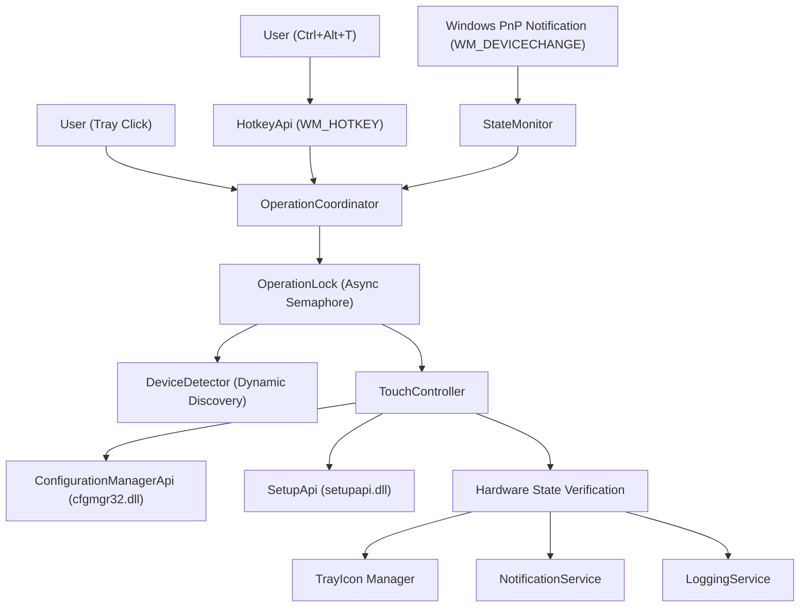

# System Architecture & Technical Design
## SamsungTouchUtility

### 1. Architectural Principles
The architecture is structured around strict separation of concerns, high-reliability native Windows API invocation, non-blocking UI responsiveness, and rigorous hardware safety controls.

### 2. Core Modules
- **`SamsungTouchUtility.Windows`**:
  - `ConfigurationManagerApi`: Low-level P/Invoke bindings for `CM_Get_DevNode_Status`, `CM_Locate_DevNode_W`, `CM_Get_Parent`, `CM_Get_Child`.
  - `SetupApi`: Low-level P/Invoke for `SetupDiGetClassDevs`, `SetupDiEnumDeviceInfo`, `SetupDiSetClassInstallParams`, `SetupDiCallClassInstaller`.
  - `HotkeyApi`: Handles `RegisterHotKey` / `UnregisterHotKey` for `MOD_CONTROL | MOD_ALT` + `VK_T` (0x54).
  - `DeviceNotifications`: Hidden native message window receiving `WM_DEVICECHANGE` (`DBT_DEVICEARRIVAL`, `DBT_DEVICEREMOVECOMPLETE`).
- **`SamsungTouchUtility.Core`**:
  - `DeviceDetector`: Implements multi-tiered heuristic evaluation to isolate touchscreen digitizers while strictly filtering out keyboards, touchpads, and stylus devices.
  - `TouchController`: Orchestrates hardware state changes, verifies pre- and post-conditions, and parses PnP return codes.
  - `OperationCoordinator`: Enforces single-operation execution and dispatches notifications.
  - `StateMonitor`: Continuously tracks device status changes initiated externally or internally.
- **`SamsungTouchUtility.Tray`**:
  - `TrayIcon`: Manages `NotifyIcon` lifecycle, tooltip updates, and user click dispatching.
  - `IconProvider`: Dynamically renders high-DPI Windows 11 rounded icons (Active Green, Disabled Red, Unknown Neutral Grey).
- **`SamsungTouchUtility.Services`**:
  - `LoggingService`: File-based diagnostic logging with retention management.
  - `StartupService`: Manages per-user Windows Run key configuration.
  - `NotificationService`: Non-intrusive Windows balloon tips.

### 3. Concurrency & Safety Guarantee
- A `SemaphoreSlim(1, 1)` lock prevents re-entrancy during hardware interrogation or manipulation.
- If an operation is requested while a toggle is in-flight, it is safely rejected or queued according to policy, preventing device driver race conditions.
- Before any change is attempted, the actual PnP problem code and devnode status are re-queried.
